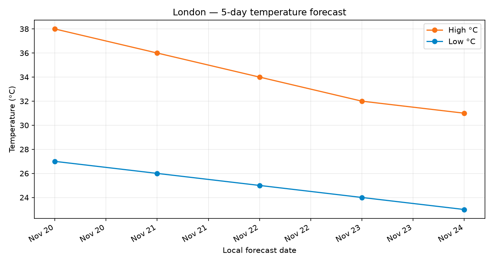
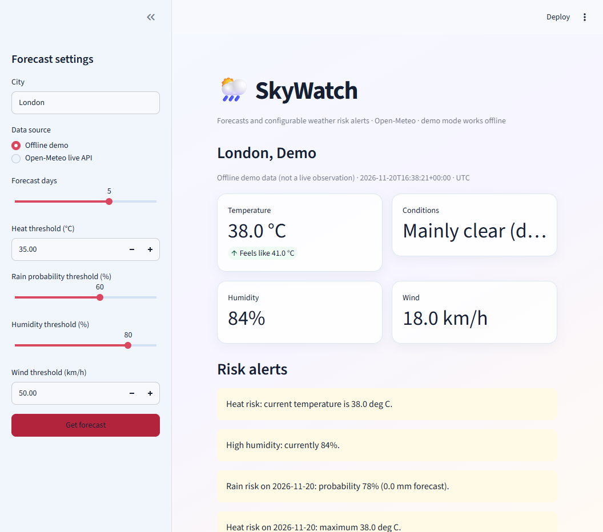

# Weather Forecast & Alert Application

A student-friendly, GitHub-ready Python project that fetches current weather and a 1–7 day forecast, applies configurable risk thresholds, and presents the result in a CLI, FastAPI API, or Streamlit dashboard. It can also run on offline sample data, so the project works without an API key or internet connection.

> **Safety note:** This is an educational forecast and threshold demo, not an official warning service. Forecasts can be uncertain. Follow local authorities and trusted meteorological services for safety decisions.

## Project overview

Enter a city → geocode it → fetch current conditions and daily forecast → normalize the JSON into typed Python models → check heat, rain, humidity, wind, and optional AQI rules → show the result → optionally save CSV, JSON, and a PNG chart.

Open-Meteo is used for live weather and geocoding. Its public endpoints do not require an API key for this educational use. Live mode does require an internet connection. Offline demo mode is deterministic and specifically contains examples that trigger risk alerts.

## Problem statement and industry relevance

Weather affects travel, outdoor work, farming, logistics, and event planning. This project demonstrates how an application can consolidate a forecast and apply user-configurable rules to make relevant conditions easier to notice. A production system could integrate provider-specific official alerts, monitoring, access control, retries, persistence, and notification delivery; this student version deliberately does not claim to replace those systems.

## Features

- Current temperature, feels-like temperature, humidity, wind, and condition description.
- Daily high/low, rain probability, precipitation estimate, weather description, and maximum wind.
- Configurable heat, rain-probability, humidity, and wind risk checks; AQI notice when the optional provider response includes it.
- Live Open-Meteo provider and offline sample provider.
- Command-line interface, FastAPI JSON API with interactive OpenAPI docs, and Streamlit dashboard.
- CSV forecast, JSON report, and Matplotlib temperature chart.
- Timeouts and actionable errors for network, HTTP, bad response, and unknown city cases.
- Unit tests for offline forecast, validation, and alert behavior.

## Tech stack

Python 3.10+, `requests`, Open-Meteo JSON APIs, `python-dotenv`, Pandas, Matplotlib, FastAPI, Uvicorn, Streamlit, and `unittest`.

## Folder structure

```text
Weather-Forecast-Alert-Application/
├── api.py                      # FastAPI routes
├── dashboard.py                # Streamlit dashboard
├── main.py                     # CLI and report generation
├── requirements.txt
├── .env.example                # Safe, non-secret configuration template
├── .gitignore                  # Excludes secrets, environments and generated files
├── data/sample_weather.json    # Human-readable sample input
├── docs/PROJECT_GUIDE.md       # Architecture, phased plan, GitHub and portfolio guide
├── images/                     # Add your own screenshots here
├── outputs/                    # Generated CSV / JSON / PNG reports (not committed)
├── reports/                    # Optional curated reports for portfolio
├── src/weather_alert/           # Models, API client, service, rules and report utilities
└── tests/test_weather_alert.py
```

## Installation

Requires Python 3.10+ and Git. From this project directory:

**Windows PowerShell**
```powershell
py -m venv .venv
.\.venv\Scripts\Activate.ps1
python -m pip install --upgrade pip
pip install -r requirements.txt
Copy-Item .env.example .env
```

**macOS / Linux**
```bash
python3 -m venv .venv
source .venv/bin/activate
python -m pip install --upgrade pip
pip install -r requirements.txt
cp .env.example .env
```

Open-Meteo has no API key in this app. `.env` stores optional local risk thresholds. Never commit `.env`, API tokens, or personal credentials; `.gitignore` excludes `.env` and `.env.*`, while allowing `.env.example`.

## Run the application

### CLI: offline demo (no network needed)
```bash
python main.py --city "London" --source demo
```

### CLI: live forecast
```bash
python main.py --city "London" --source live --days 5
```
Live mode needs an internet connection. Change alert thresholds from command-line flags, for example:
```bash
python main.py --city "Delhi" --source live --max-temp 37 --rain-probability 70 --max-humidity 85 --max-wind 45
```
Supported options: `--city`, `--source live|demo`, `--days 1..7`, `--max-temp`, `--rain-probability`, `--max-humidity`, `--max-wind`, and `--output-dir`. With no `--city`, the CLI prompts for one. Threshold defaults may also be set in your local `.env`.

### Streamlit dashboard
```bash
streamlit run dashboard.py
```
Choose a source and thresholds in the sidebar, select **Get forecast**, then optionally save the report files.

### FastAPI service
```bash
uvicorn api:app --reload
```
Open <http://127.0.0.1:8000/docs>. Example requests:
```text
GET http://127.0.0.1:8000/health
GET http://127.0.0.1:8000/weather/London?source=demo&days=5
GET http://127.0.0.1:8000/weather/London?source=live&days=3&max_temp=34&rain_probability=60
```
The API returns JSON containing `weather`, `alerts`, and `thresholds`. Use `source=demo` for predictable offline testing.

## Sample output

Offline demo weather conditions are fixed and reproducible (forecast dates are generated relative to today). Exact report filenames have a run timestamp.

```text
Weather Forecast & Alert Application — London, Demo
Source: Offline demo data (not a live observation) | Local time: <current UTC time> | UTC
Now: 38.0 °C (feels like 41.0 °C), Mainly clear (demo), humidity 84%, wind 18.0 km/h

Forecast:
  <today>: Mainly clear; 27.0–38.0 °C; rain 78% (0.0 mm); wind 18.0 km/h
  <tomorrow>: Moderate rain; 26.0–36.0 °C; rain 85% (8.2 mm); wind 24.0 km/h
...

Alerts:
  ⚠ Heat risk: current temperature is 38.0 °C.
  ⚠ High humidity: currently 84%.
  ⚠ Rain risk on <today>: probability 78% (0.0 mm forecast).
...

Saved files:
  CSV: outputs/weather_london_<timestamp>.csv
  JSON: outputs/weather_london_<timestamp>.json
  CHART: outputs/weather_london_<timestamp>.png
```

The demo conditions are deliberately illustrative, not real observations. Live forecast conditions and alert messages depend on the provider and selected thresholds.

## Reports and screenshots

CSV contains one row per forecast date. JSON contains location, current observations, forecast, thresholds, and generated alerts. PNG plots forecast highs and lows. Generated files go to `outputs/` and are ignored by Git to avoid committing changing output automatically. To show portfolio evidence, add screenshots to `images/` and optionally copy a sanitized sample report to `reports/` after checking it contains no secrets or sensitive location data.

Recommended screenshots: folder structure, demo CLI with alerts, live CLI (if network is available), Streamlit dashboard, API `/docs` and demo response, CSV/chart, and the GitHub repository page. See [docs/PROJECT_GUIDE.md](docs/PROJECT_GUIDE.md) for an exact capture checklist and project walkthrough.

### Sample forecast chart



### Streamlit dashboard



## Tests

```bash
python -m unittest discover -s tests -v
```
Tests use demo mode and do not need network access or API keys.

## Learning outcomes

- Calling REST endpoints, handling JSON, timeouts, HTTP errors, and invalid input.
- Separating provider, domain models, rules, output generation, and user interfaces.
- Applying threshold-based analysis and writing regression tests.
- Building a CLI, REST API, and interactive data dashboard around one service layer.
- Producing reproducible data reports/charts and protecting local configuration in Git.
- Explaining design limitations, data provenance, and safety boundaries in a portfolio interview.

## Extensions

Add persistence (SQLite), caching/rate-limit handling, provider interfaces, more test coverage using mocked HTTP responses, official alert feeds where available, a map, multilingual labels, scheduled jobs, or email/SMS via a properly secured provider account. Notification sending is intentionally not enabled in this version.

## Data source and attribution

Live forecast: [Open-Meteo](https://open-meteo.com/) · Location search: [Open-Meteo Geocoding API](https://open-meteo.com/en/docs/geocoding-api) · Optional AQI: [Open-Meteo Air Quality API](https://open-meteo.com/en/docs/air-quality-api). Check their current terms, attribution requirements, and usage limits before deployment or commercial use.
